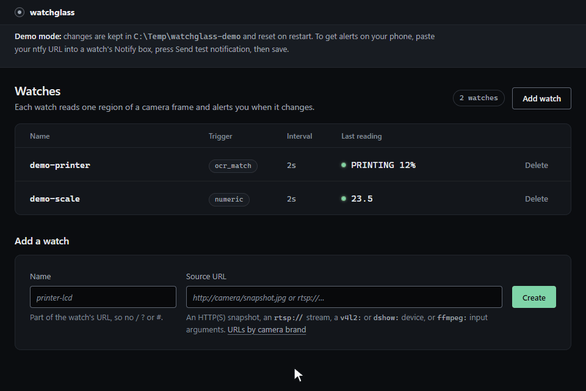
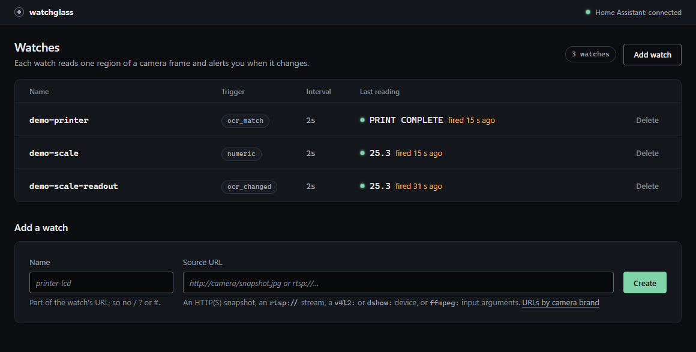
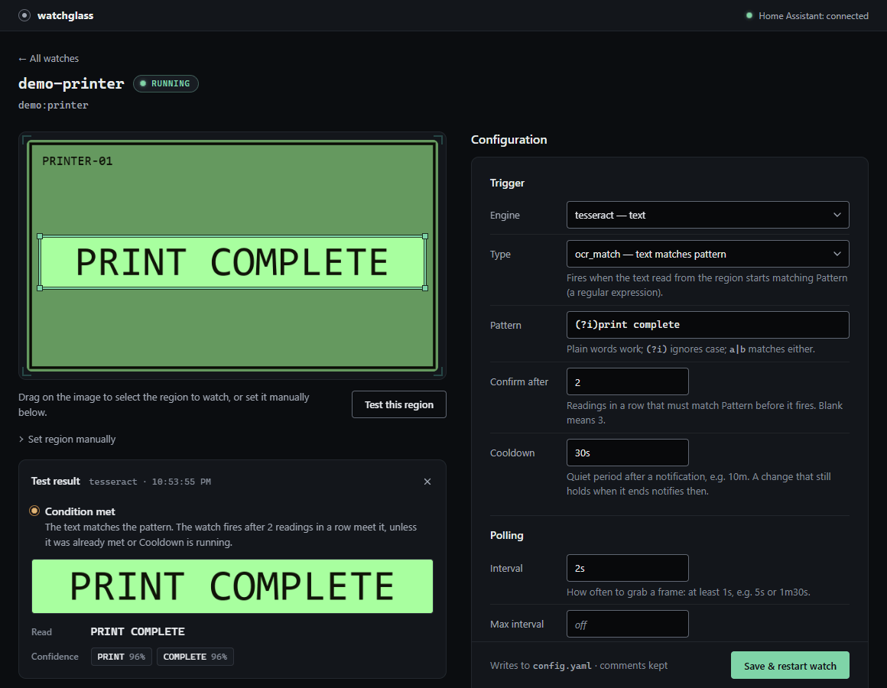
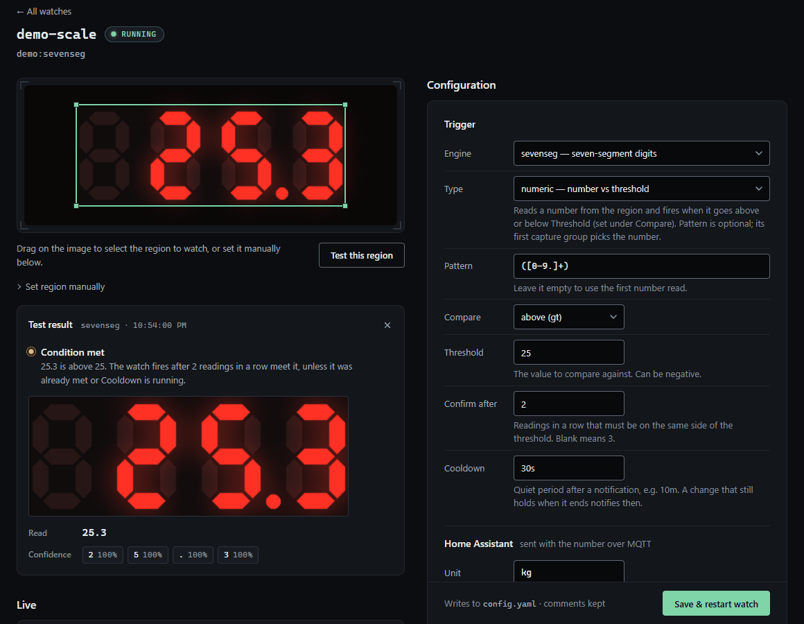

# watchglass

**Read the digits or the status text on a screen that has no API, and get an alert on your phone when they show what you're waiting for. It runs locally, with or without Home Assistant.**

You have a device whose only output is its screen: a boiler, a heat pump, a 3D printer, a bench scale. Point a camera you already own at it and drag a box around the part you care about. Every few seconds watchglass reads the box: seven-segment digits with its own decoder, or words and fault codes with tesseract. When the boiler shows E04 or the scale passes 25, an alert goes straight to your phone over ntfy (with the crop), Telegram, Discord or email, with no automation to write. A number can also become a Home Assistant sensor with a graph. One binary or a Docker image, and only the alerts you set up leave your network.

[](https://github.com/darrenhuai/watchglass/releases/latest)
[](https://github.com/darrenhuai/watchglass/pkgs/container/watchglass)

[](LICENSE)

## Try it in a minute (no camera needed)

```bash
docker run --rm -p 127.0.0.1:8080:8080 -e WATCHGLASS_DEMO=1 ghcr.io/darrenhuai/watchglass
```

Open http://127.0.0.1:8080. The first run downloads the image (about 240 MB); after that it starts in a second or two. Two demo watches fire about 25 seconds in; this clip is that run, and its ntfy alerts go to a local test receiver:



- **Draw, test, save.** Drag a box over the live frame and see what it reads before you save. No YAML.
- **Reads the screen.** Seven-segment digits on LED, VFD and backlit displays (built-in decoder, no ssocr), text and fault codes (tesseract), or pixel change.
- **Confirms before it fires.** A reading has to hold for a few polls before it counts, a cooldown stops repeat pings, and a restart doesn't repeat an alert.
- **Notifies anywhere.** ntfy, Discord, Telegram, Slack, Pushover, email and webhooks.
- **Home Assistant if you want it.** Over MQTT, each watch is a device and a number is a sensor. Works with HA Container and Core; on HA OS there's an add-on.
- **Tells you when the camera dies.** One "down" alert and one "back up" alert, even across a restart.
- **Runs on what you have.** Snapshot URLs, MJPEG and RTSP, webcams, your own screen. No GPU. The demo uses about 27 MB of RAM in Docker on Linux; 12 watches reading every second or two used about 80 MB on Windows, not counting tesseract.

No Docker? Unpack the [archive for your system](https://github.com/darrenhuai/watchglass/releases/latest) and run `watchglass -demo`.

Gave up on Home Assistant's seven_segments/ssocr? [Moving over from ssocr](docs/recipes/from-seven-segments.md) maps your old settings to a watch.

## Install

> watchglass is v0.x: the config format may still change between minor versions.

**Docker Compose.** The image includes ffmpeg and tesseract and runs on amd64, arm64 and armv7. It needs Docker's [Compose plugin](docs/install.md#docker-compose).

```bash
mkdir -p watchglass/config && cd watchglass
curl -fsSLO https://raw.githubusercontent.com/darrenhuai/watchglass/master/docker-compose.yml
PUID=$(id -u) PGID=$(id -g) docker compose up -d
```

Open http://127.0.0.1:8080. If it doesn't open, `docker compose logs` says why. Your config and history live in `./config`. The port is bound to localhost only; add an [`auth:` block](docs/security.md) before you open it to your network.

**Binary.** On Linux, in one line (it needs curl: `sudo apt install curl`):

```bash
curl -fsSL https://github.com/darrenhuai/watchglass/releases/latest/download/watchglass_linux_amd64.tar.gz | tar xz && ./watchglass_linux_amd64/watchglass
```

Or unpack the archive for your system from [Releases](https://github.com/darrenhuai/watchglass/releases/latest) and run `./watchglass`, or double-click `watchglass.exe`. The first run creates an empty `config.yaml` in the current folder and prints the address to open. It only answers on this machine; to open it from another one, add an [`auth:` block](docs/security.md#reaching-it-from-other-machines) and start it with `-listen 0.0.0.0:8080`. Reading text needs tesseract, and RTSP, webcams and screen capture need ffmpeg ([what to install](docs/install.md#what-to-install-for-reading-text-and-streams)); seven-segment digits and snapshot URLs need nothing extra.

The Home Assistant add-on, `docker run`, systemd, [checksums](docs/install.md#checking-the-download) and building from source: [docs/install.md](docs/install.md).

## Your first watch

1. Under **Add your first watch**, enter a name and your camera's snapshot or RTSP URL. The [camera URL cookbook](docs/recipes/camera-urls.md) lists them by brand.
2. On the watch's page, drag a box over what you care about and press **Test this region**.
3. Pick a trigger preset: **Status text**, **Digit display** or **Any change**. For text, set a pattern such as `(?i)print complete`.
4. Subscribe to a topic of your own in the [ntfy app](https://ntfy.sh), paste `ntfy://ntfy.sh/<your-topic>` into Notify, press **Send test notification**, then **Save & restart watch**.

Other services take the URL forms in [docs/notifications.md](docs/notifications.md).

## Screenshots







## Recipes

Configs to copy, most tested against a [sample frame](docs/recipes/samples/): [heat pump and boiler panels](docs/recipes/heat-pump-boiler-panel.md), [a washer's countdown](docs/recipes/appliance-time-remaining.md), [server consoles and KVMs](docs/recipes/server-console-ipmi.md), and [the rest](docs/recipes/README.md).

Don't see your screen? [Ask for a recipe](https://github.com/darrenhuai/watchglass/issues/new?template=recipe.yml) and attach a frame.

## When to use something else

A device's own port, radio or API beats any camera:

| For | Use |
|---|---|
| A meter with an optical port or M-Bus | An IR read head, or an M-Bus or wM-Bus reader |
| Meter counters on HA OS, with review tools | [VisionState](https://github.com/oleost/VisionState) (digits only, no words) |
| A rolling water or gas meter | [AI-on-the-edge-device](https://github.com/jomjol/AI-on-the-edge-device), or VisionState on HA OS |
| Which status LED is lit | An LDR on each LED, or VisionState's trained states |
| A wireless thermometer | [rtl_433](https://github.com/merbanan/rtl_433) and an SDR dongle |
| When the washer is done | A power-monitoring plug and [WashData](https://github.com/3dg1luk43/ha_washdata) |
| A device with an API or a serial port | Its own integration |
| Questions about what a camera sees | [LLM Vision](https://github.com/valentinfrlch/ha-llmvision) |
| Digits, status text or fault codes on a screen, with alerts | watchglass |

watchglass reads lit digits best. On reflective LCDs, which most utility meters have, it got 8 of 28 readings from real photos right, and it has no meter-total sensor for the Energy dashboard. Not for life-safety or medical devices.

## Documentation

[Install](docs/install.md) · [Sources](docs/sources.md) · [Configuration](docs/configuration.md) · [Notifications](docs/notifications.md) · [Home Assistant](docs/home-assistant.md) · [Security](docs/security.md) · [Contributing](CONTRIBUTING.md)

## License

MIT. MQTT support uses the Eclipse Paho Go client (EPL-2.0/EDL-1.0).
