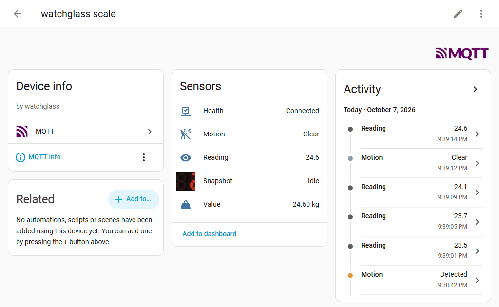
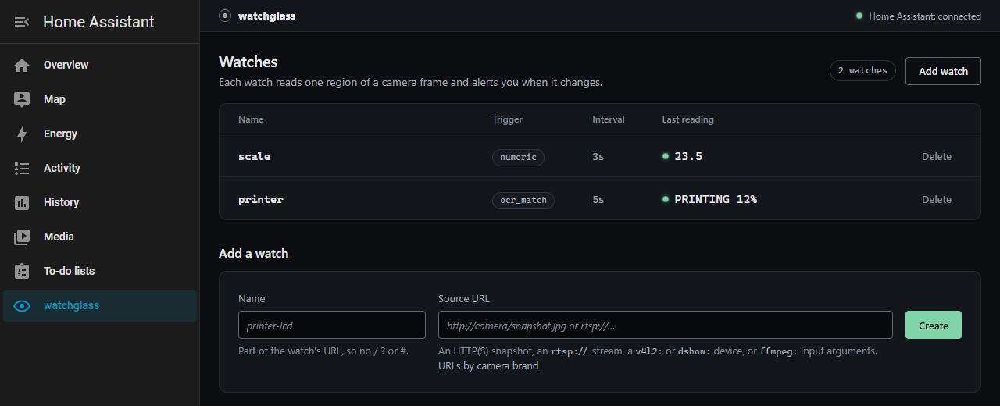

# Home Assistant

watchglass talks to Home Assistant over MQTT, using HA's [MQTT discovery](https://www.home-assistant.io/integrations/mqtt/#mqtt-discovery). Add an `mqtt:` block to `config.yaml` and every watch shows up in HA as a device, with nothing to configure on the HA side. This page was last checked against Home Assistant 2026.10.0 with a Mosquitto broker.

```yaml
mqtt:
  broker: tcp://homeassistant.local:1883
  username: watchglass
  password: <PASSWORD>
```

With the Mosquitto broker add-on, the broker is `tcp://core-mosquitto:1883` from the watchglass add-on, or `tcp://<home-assistant-host>:1883` from anywhere else; create an HA user for watchglass and use its login. Other brokers work too: `tcp://`, `ssl://`, `mqtt://`, `mqtts://` and `ws://` are accepted.

Optional keys: `client_id` (default `watchglass`), `base_topic` (default `watchglass`) and `discovery_prefix` (default `homeassistant`).

Running more than one watchglass on one broker? Give each its own `client_id` and `base_topic`. Two with the same `client_id` keep knocking each other off the broker. Two with the same `base_topic` share one availability topic, so when either stops, HA shows both as unavailable, and a watch name used in both becomes one device they fight over. watchglass logs a warning when it sees another one on its `base_topic`, and leaves that one's devices alone.

watchglass publishes its discovery configs under `homeassistant/` (your `discovery_prefix`) and reads there too: its own old discovery messages, so it can remove the devices of watches that are gone, and HA's status on `homeassistant/status`, so it knows when HA starts and stops. It keeps a list of its watches on `<base_topic>/.owners/<client_id>`, so another watchglass on the broker never takes them for leftovers. If your broker limits what each user may do, give the watchglass user read and write access to both `homeassistant/#` and `<base_topic>/#`. Without the read access everything else works, but a device can be left behind in HA after a watch is deleted or renamed.

Changed `client_id`? The list under the old one stays on the broker. watchglass deletes it on start when it names any of the current watches. If every watch was renamed at the same time, it can't tell, and logs a warning about "another watchglass" on every start: delete the retained message on `<base_topic>/.owners/<old client_id>` yourself, for example with `mosquitto_pub -r -n -t <topic>`.

Changes to the `mqtt:` block take effect after a restart. The broker password is stored in plain text, like every password in `config.yaml`; watchglass writes the file readable only by its owner on Linux and macOS.

## The entities

Each watch becomes a device named `watchglass <watch name>` with these entities:

| Entity | Type | What it shows |
|---|---|---|
| Reading | sensor | The text read, once it has held (below). HA keeps 255 characters, so a longer reading is cut and ends in `…`. |
| Value | sensor | `numeric` and `value` watches only: the number, which HA can graph and keep statistics for. |
| Health | binary sensor (connectivity) | Online while frames are read, offline once the watch counts as down. Online from the first frame read. |
| Motion | binary sensor (motion) | On for 30 seconds each time the trigger fires. A `value` watch never fires, so it has none. |
| Snapshot | camera | The cropped region from the last fire, turned upright if the watch uses `rotate`. Empty until the watch first fires. |

HA puts the device name in front, so the Value of a watch called `boiler` is "watchglass boiler Value", with the entity ID `sensor.watchglass_boiler_value`.



State is published with the retain flag, so it survives an HA restart. watchglass announces its own availability with an MQTT last-will message, so its entities go unavailable if it stops. It only publishes changes.

Delete a watch and its device goes from HA too. A watch renamed in `config.yaml` is a new device with new entity IDs, so automations that used the old ones need the new ones; the old device goes away when watchglass starts again. If HA is stopped or away from the broker at that moment, the device goes when HA is back, as long as watchglass is still running then. A device left behind anyway can be deleted from its page in HA.

### Readings that don't flap

The Reading entity only changes when a reading has held for `confirm` polls in a row, so a frame misread through glare never reaches HA.

- For a `numeric` or `value` watch, the Value is the middle (median) of the last 2 × `confirm` − 1 numbers read. With `confirm: 2` or more, a misread digit never reaches the history graph; with `confirm: 1`, every number read is sent. A value that changes on every poll, like power draw, is still followed, one reading behind. The Reading is the text that number came from, or what the panel shows instead of a number (`Err`, `OFF`) once that has held. A seven-segment reading with a `?` anywhere in it (a digit the decoder couldn't read, or read too unsurely to tell from another digit) is skipped, so a display at 71.0 read as `??.0` never sends 0.
- For an `ocr_match` or `ocr_changed` watch on `sevenseg`, a `?` reading the watch skips (the pattern doesn't match it) or takes as its last text read partly (`?2.5` after `22.5`) doesn't reach the Reading either; one the pattern catches on purpose (`End` read as `?`) does.
- For `pixel_change`, the Reading is the change percentage. It's sent at once when it crosses the threshold in either direction, and otherwise at most once a minute, so camera noise doesn't make a new state every frame.

### Units and device classes

Give a `numeric` or `value` watch a unit and a device class and HA treats the Value as a proper measurement, with long-term statistics. They're under **Home Assistant** on the watch's page, or in `config.yaml`:

```yaml
watches:
  - name: boiler
    source: http://192.168.1.60/snapshot.jpg
    region: {x: 0.3, y: 0.3, w: 0.3, h: 0.2}
    engine: sevenseg
    unit: "°C"
    device_class: temperature
    trigger:
      type: numeric
      op: lt
      threshold: 40
```

| `device_class` | Units HA accepts |
|---|---|
| `temperature` | °C, °F, K |
| `humidity` | % |
| `pressure` | hPa, kPa, Pa, mPa, bar, cbar, mbar, psi, mmHg, inHg, inH₂O, atm |
| `power` | W, kW, mW, MW, GW, TW |
| `voltage` | V, mV, μV, kV, MV |
| `current` | A, mA, μA |
| `weight` | kg, g, mg, μg, lb, oz, st |
| `duration` | s, min, h, d, ms, μs |
| `energy` | kWh, Wh, MWh, GWh, TWh, mWh, J, kJ, MJ, GJ, cal, kcal, Mcal, Gcal, thm |
| `water` | m³, L, gal, ft³, CCF, MCF |
| `gas` | m³, L, ft³, CCF, MCF |
| `volume` | L, mL, m³, gal, fl. oz., ft³, CCF, MCF |
| `battery` | % |
| `ph` | no unit |

A device class needs one of its units (`ph` takes none). Without a device class, the unit is free text of up to 16 characters (`rpm`, `L`). HA spells micro with the Greek μ; a `µ` typed on a keyboard is changed into it when you save. Both fields are refused on a watch that isn't `numeric` or `value`.

When a watch stops having a number, watchglass sends an empty config for its Value entity at start-up so HA removes it. That's expected in the broker log.

## Meters and the Energy dashboard

The Value's state class tells HA what kind of number it is. Most are `measurement`: a reading at a moment, like a temperature. A counter ([configuration.md](configuration.md#counters)) is `total_increasing`: a running total, which HA turns into a sum per hour and day, and which the Energy dashboard reads. A watch with the `energy`, `water`, `gas` or `volume` device class is always a counter, since HA keeps those only as totals; `counter: true` makes any other value one (with no device class, or `weight` or `duration`). Every other device class stays `measurement`, so a `numeric` watch from before keeps the sensor it had.

To put an electricity meter on the Energy dashboard:

1. Make a `value` watch on the meter's total with `device_class: energy` and `unit: kWh` (the [meter recipe](recipes/meter-energy-dashboard.md) has one).
2. In HA, open the Energy settings (**Settings → Dashboards → Energy**), and under **Electricity grid** press **Add grid connection** and pick the watch's Value, "watchglass <name> Value".
3. HA builds its statistics every 5 minutes; as its own note says, new data can take up to 2 hours to show on the dashboard.

A water meter goes under **Water consumption** with `device_class: water`, and a gas meter under **Gas consumption** with `device_class: gas`.

A counter never sends HA a lower value, and a rise above `max_rise` only after the readings agree on it ([rise limit](configuration.md#rise-limit)), so one misread frame can't add a year's energy to the dashboard. **After replacing a meter**, the new one starts low and the watch holds that back: press **Accept** under the held value on the watch's page. HA then sees the total drop, takes it as a new meter (that is what `total_increasing` means) and goes on adding from there; the energy used before stays in the statistics. HA counts the new meter from zero, so whatever it shows when you accept it is added once as used.

**If a wrong high value got through** (a counter without `max_rise`, or a misread that lasted longer than the readings the limit needs), every right reading after it is lower, so the watch holds them all back. Accept the right value on the watch's page, then open **Developer tools → Statistics** in HA, find the watch's Value and adjust the sum at the spike: HA counts the accepted value from zero as a new meter, so without that the whole meter total, thousands of kWh, lands on the dashboard once. Give every meter a `max_rise` so this doesn't happen.

## Is it connected?

With an `mqtt:` block, the top of every page says **Home Assistant: connected**, **connecting…**, or **not connected** with the reason: connection refused, wrong username or password, no answer, certificate not trusted and so on. Hover over it for the broker address and the raw error. Connected means watchglass is connected to the broker and HA hasn't said it's offline. When HA stops, it says so over MQTT, and the line reads **not connected: it went offline; the MQTT broker is up** until HA is back. HA doesn't leave that message on the broker, so a watchglass started while HA is down says connected. The log says the same about the broker, at most once a minute:

```text
mqtt: can't connect to tcp://homeassistant.local:1883: connection refused (retrying): …
```

If the broker is down, watchglass keeps watching, retries at least every 15 seconds, and sends everything that changed once it's back. MQTT is never allowed to take the watcher down with it.

## The add-on

The watchglass add-on runs the same image inside Home Assistant (amd64 and aarch64) and opens from the Home Assistant sidebar, behind Home Assistant's own login, with no port open on your network unless you map one. With the Mosquitto broker add-on next to it, the `mqtt:` block above with `tcp://core-mosquitto:1883` and an HA user's login is all it needs.



It's experimental. It was checked on Home Assistant 2026.10.0 with Supervisor 2026.09.3 on amd64, in Home Assistant's add-on development container, but not yet on Home Assistant OS or a Raspberry Pi. See [addon/DOCS.md](../addon/DOCS.md) for how to install it, how to reach it directly if you want to, and what to watch out for.

Entity names changed in 0.1.8, from "watchglass printer printer reading" to "watchglass printer Reading". The entity IDs didn't change, so automations keep working.
